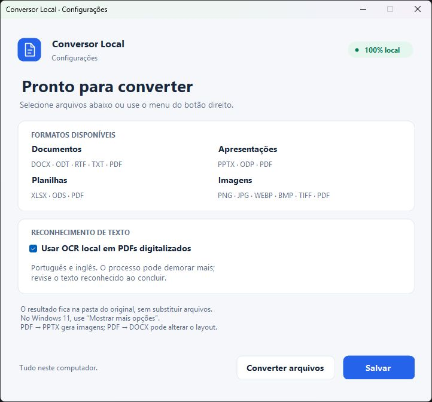

# Conversor Local para Windows

Aplicativo gratuito e offline para Windows 10/11 **x64**, com C#/.NET 10, uma extensão nativa `IExplorerCommand` e motores privados de conversão. O File Converter não é instalado nem utilizado.

**[Baixar o instalador 1.1.0 para Windows x64](https://github.com/diogo9467/conversor-local/releases/download/v1.1.0/ConversorLocal-1.1.0-win-x64-Setup.exe)** · [Versões, fontes e evidências](https://github.com/diogo9467/conversor-local/releases)



## Instalação e uso

1. Baixe o instalador pelo link acima e execute `ConversorLocal-1.1.0-win-x64-Setup.exe`.
2. Instale para seu usuário. Não são necessários administrador, Python, Office, LibreOffice pré-instalado, conta ou internet.
3. Abra **Configurações do Conversor Local** pelo menu Iniciar e clique em **Converter arquivos**.
4. Selecione um ou vários arquivos, escolha um dos formatos compatíveis e clique em **Converter**. A janela permite acompanhar e cancelar.

A extensão do Explorador também está incluída: **Mostrar mais opções → Converter arquivo** no Windows 11. O contrato nativo e o despacho pelo Shell foram testados; nesta sessão, o Explorador não exibiu o novo item, e o clique visual continua pendente. A seleção pela janela do aplicativo foi validada e está disponível imediatamente.

| Origem | Destino | Como funciona |
| --- | --- | --- |
| DOCX, ODT, RTF, TXT | Os demais formatos desse grupo e PDF | LibreOffice Writer local |
| PPTX, ODP | O outro formato e PDF | LibreOffice Impress local |
| XLSX, ODS | O outro formato e PDF | LibreOffice Calc local, respeitando a configuração de impressão salva |
| PDF | DOCX | Reconstrução de texto, tabelas e imagens com pdf2docx; OCR local opcional |
| PDF | PPTX | Uma imagem de alta resolução por página/slide, sem recorte |
| PDF | TXT | Extração de texto; OCR local opcional para digitalizações |
| PNG, JPG/JPEG, WEBP, BMP, TIF/TIFF | PNG, JPG, WEBP, BMP, TIFF e PDF, exceto o próprio formato | Conversão local de imagens, sem redimensionamento dos pixels |

O resultado sempre fica **na pasta de origem**, com o mesmo nome-base. Arquivos existentes recebem `(1)`, `(2)`, etc. O original e qualquer destino existente são preservados. A falta de permissão de escrita gera erro, sem salvar em outra pasta. Não há seletor de pasta de saída, abertura automática do resultado ou nova janela do Explorador. A notificação `SHChangeNotify` atualiza a pasta e mantém a ordenação do Windows.

Um lote processa os arquivos sequencialmente para limitar memória; conversões iniciadas separadamente são isoladas e podem executar simultaneamente. Uma falha não interrompe os demais arquivos. O menu oferece apenas destinos compatíveis com **todos** os selecionados: DOCX e PNG oferecem PDF; PDF e DOCX oferecem TXT. Seleções sem um destino comum não exibem o comando.

Uma imagem TIFF com várias páginas ou WEBP animado pode gerar PDF/TIFF com todos os quadros. Para PNG/JPG/WEBP/BMP de um único quadro, essa origem é recusada com explicação: nenhuma página é descartada silenciosamente. O conversor não junta imagens de arquivos separados em um único PDF; cada origem gera seu próprio resultado.

### OCR

Em **Iniciar → Conversor Local → Configurações**, é possível ativar/desativar o OCR. Ele está ativado inicialmente, funciona apenas na máquina e inclui português/inglês. O motor Tesseract é incorporado ao MuPDF; os modelos estão em `ocr/tessdata`. A desativação impede a execução de novo reconhecimento; uma camada OCR já existente pode ser recuperada. Revise palavras e números reconhecidos. Páginas digitalizadas geram texto editável com reconstrução aproximada; imagens/tabelas existentes somente no raster não são necessariamente recuperadas como objetos separados.

### Windows 11 e assinatura

Esta edição tem instalador **sem assinatura digital** e registra a integração no menu clássico. O Windows pode mostrar editor desconhecido. O aplicativo não importa certificados, muda políticas, desativa verificações ou reinicia o Explorador. Consulte [a validação da versão 1.1.0](docs/extended-formats.md) para os testes executados.

A extensão para o menu moderno e seu manifesto de identidade estão implementados. O pacote `artifacts/ConversorLocal-Shell-1.1.0-x64-unsigned.msix` é gerado pelo MakeAppx oficial, mas **não pode ser instalado normalmente sem assinatura confiável**. O fluxo de assinatura/instalação está em [docs/windows-shell.md](docs/windows-shell.md). Não confundir um MSIX empacotado com uma integração moderna instalada/testada.

### Desinstalação

Use **Configurações do Windows → Aplicativos → Conversor Local → Desinstalar**, ou o atalho do menu Iniciar. O desinstalador remove os binários e apenas as chaves de shell pertencentes ao aplicativo. As associações padrão e os documentos não são alterados. Preferências e logs locais são preservados para diagnóstico; podem ser removidos manualmente depois.

## Limitações reais

- Fontes ausentes, campos, diagramas complexos, objetos OLE, efeitos e animações do Office podem diferir no LibreOffice. Animações não aparecem em PDF estático. Slides ocultos são incluídos na exportação para manter um PDF por slide.
- PDF não contém a estrutura original de um Word: paginação, colunas, tabelas complexas, fórmulas e ordem de leitura podem mudar. O resultado requer revisão.
- PDF → PPTX preserva a aparência por imagens (até 200 dpi, máximo de 5.000 pixels por lado e 24 megapixels por página). Os elementos não são editáveis individualmente. PDFs com formatos variados usam margens, sem deformação.
- TXT preserva somente texto. Entradas aceitam UTF-8, UTF-16 com BOM e Windows-1252, até 32 MB; a saída é UTF-8. Imagens, layout e formatação não são preservados. OCR e ordem de leitura precisam de revisão.
- Conversões entre formatos editáveis podem alterar recursos específicos, fórmulas e fontes. PDFs de planilhas seguem áreas de impressão, escala e visibilidade salvas; não forçam abas ocultas nem uma página por aba.
- RTF com campos, objetos OLE ou referências a arquivos é recusado antes da abertura. Nesse caso, salve uma cópia autossuficiente em DOCX. Planilhas com macros, conexões de dados ou vínculos externos também são recusadas.
- JPG usa compressão com perda em qualidade 95; WEBP usa compressão sem perda. JPG/BMP e PDF recebem fundo branco onde havia transparência. A orientação EXIF é aplicada aos pixels; metadados podem ser descartados e a duração de animação não é preservada. Limites: 500 páginas/quadros, 40 megapixels por quadro e 120 megapixels no total.
- Arquivos com senha são recusados com mensagem. Não há prompt de senha nem tentativa de removê-la. PDFs que proíbem cópia e documentos que dependem de imagens/dados externos não incorporados também são recusados. Referências a modelos `.dot/.dotm/.dotx` são desligadas somente na cópia temporária: o texto, os estilos e as imagens já gravados no DOCX são preservados, sem acessar o modelo.
- Arquivos grandes exigem memória, espaço no volume temporário e no volume de origem; há limite de 30 minutos por arquivo. Pacotes Office maiores que 2 GB descompactados ou 30 mil entradas são recusados.
- Caminhos longos foram previstos no host .NET; os motores recebem cópias com nomes curtos em uma pasta temporária. Nomes que excedam os limites do sistema de arquivos falham, sem redirecionamento.
- Esta entrega é x64. Windows ARM64 e Windows 32 bits não foram validados.
- Testes estruturais e visuais não equivalem a garantia de fidelidade de todos os documentos possíveis. Veja [docs/test-report.md](docs/test-report.md) para o que foi efetivamente executado.

## Arquitetura e segurança

`src/Conversor.App`: host WinForms, seleção de arquivos/formato, progresso e preferências. `src/Conversor.Core`: snapshot somente de leitura, subprocessos isolados, cancelamento, validação do protocolo, publicação atômica e notificação ao shell. `src/Conversor.Shell`: DLL C++ com `IShellExtInit`/`IContextMenu` para o menu clássico e `IExplorerCommand` para a identidade moderna, que apenas inspeciona extensões e despacha a seleção para o host fora do Explorador. `engine/worker.py` e `engine/extra_formats.py`: validação e conversões locais. `installer/`: instalador por usuário e manifesto MSIX. `formats.json` é o catálogo compartilhado de rotas; `tools/catalog.py` gera as declarações nativas, de registro e do manifesto moderno.

O host não entrega o caminho original ao motor. Cada trabalho usa `%LOCALAPPDATA%/ConversorLocal/jobs/<id>`. A saída é validada antes de copiar para um arquivo `.partial` na pasta de origem e renomear atomicamente sem substituição. Um Job Object do Windows encerra os processos filhos ao fechar o host. Temporários são removidos no encerramento normal, falha ou cancelamento. Um encerramento forçado do sistema pode deixar o snapshot temporário; ele não é publicado como documento final.

Não há cliente HTTP, telemetria, login ou upload no aplicativo. Macros são desativadas no perfil LibreOffice exclusivo. Modelos externos do Word são desvinculados na cópia privada; imagens/dados que exigiriam acesso externo são recusados antes de abrir no Office headless. Uma pasta não confiável não deve ser usada como destino de instalação; instale no caminho padrão do instalador. O aplicativo não é um sandbox para documentos hostis e deve receber atualizações de seus motores.

Logs JSONL locais ficam em `%LOCALAPPDATA%/ConversorLocal/logs`. Incluem nomes/caminhos e erros, sem enviar informações. Preferências ficam em `settings.json` nessa mesma raiz. Não envie logs a terceiros sem conferir os caminhos que contêm.

## Desenvolvimento e manutenção

Somente quem recompila precisa de **Python 3.12 x64**, PowerShell, acesso à internet para provisionar as ferramentas e cerca de 8 GB livres. O usuário do instalador não precisa deles.

```powershell
powershell -NoProfile -File tools/prepare.ps1
.tools/build-python/Scripts/python.exe tools/build.py
```

`prepare.ps1` mantém SDK, compilador, dependências e LibreOffice dentro do projeto. Não define PATH permanente nem instala LibreOffice globalmente. Pacotes principais são fixados em `engine/requirements.txt`; o ambiente completo está em `tools/requirements-build.lock.txt`. Hashes upstream são verificados quando publicados e os artefatos finais têm SHA-256 em `artifacts/SHA256SUMS.txt`. Conexão é usada apenas durante a preparação da compilação.

Para testes, execute `tools/test.ps1`. Os documentos são sintéticos e reproduzíveis, criados em `test-results/fixtures`, sem dados pessoais. Os testes de integração chamam o executável C# e o motor congelado que serão distribuídos, não somente funções Python. É necessário executar fora de um sandbox que bloqueie processos Win32 ou a renomeação de arquivos.

Ao atualizar um motor, altere as versões/hashes, recompile, execute os testes e confira visualmente as evidências. Consulte [docs/architecture.md](docs/architecture.md). A CI Windows em `.github/workflows/windows.yml` está preparada; sua execução remota não é presumida nesta entrega.

## Licenças e fontes

O código do Conversor Local é **AGPL-3.0-or-later**, compatível com a distribuição do PyMuPDF/MuPDF. A instalação inclui o código-fonte do aplicativo, os fontes exatos do motor AGPL e seus avisos em `sources/` e `licenses/`. LibreOffice e demais componentes mantêm suas próprias licenças; veja [THIRD-PARTY-NOTICES.md](THIRD-PARTY-NOTICES.md) e `dependency-manifest.json`. Não há dependência do File Converter nem código copiado desse projeto.
