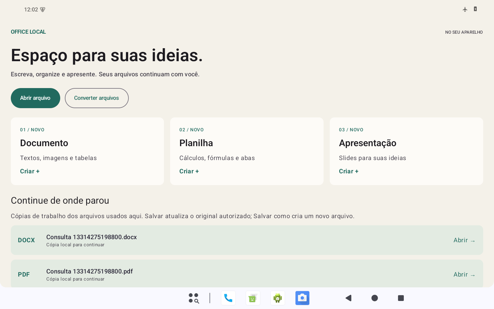

# Office Local para Android

Suíte offline para tablets, baseada no aplicativo Android real do Collabora Office 26.04.4.2. O mesmo APK contém Writer, Calc, Impress, consulta de PDF e o conversor existente. Não exige outro Office, servidor, conta ou download de motores.

A integração aplica uma camada pequena sobre uma revisão fixa do upstream, sem importar seu histórico. `android/`, Windows e os workflows existentes permanecem preservados. Consulte a [referência anterior](docs/baseline.md) e o [relatório de validação](docs/validation.md).

[Baixar a prévia Android 0.2.0](https://github.com/diogo9467/conversor-local/releases/tag/office-android-v0.2.0-test.1) — APKs, hashes, fontes e evidências. Para o tablet, escolha `OfficeLocal-0.2.0-arm64-test.apk` (aproximadamente 400 MB).



## Usar

Instale o APK **ARM64** da entrega no tablet com Android 8 ou posterior. O pacote `dev.diogo.officelocal` convive com o conversor anterior e com o Collabora oficial. Esta é uma versão independente, com assinatura de desenvolvimento. A compatibilidade com o tablet físico ainda precisa ser confirmada.

- **Abrir arquivo** usa o seletor Android: DOCX/ODT, XLSX/ODS, PPTX/ODP e PDF para consulta.
- **Documento, Planilha e Apresentação** criam arquivos novos. As ferramentas de edição são as do Collabora.
- Se o documento abrir em modo de consulta, toque no **lápis** para ativar a edição. PDFs permanecem para consulta; use Converter para gerar um DOCX editável.
- **Arquivo → Salvar** atualiza o original somente com permissão efetiva de escrita, depois de salvar a cópia de trabalho e conferir a gravação por leitura. Se o original mudou externamente, pede uma nova cópia.
- **Salvar como…** escolhe formato e pasta. **Exportar PDF** usa o estado atual e cria outro arquivo. Colisões recebem `(1)`, `(2)` etc.
- Exportações/conversões usam a pasta original apenas quando há autorização de diretório e ela é identificável pelo provedor. Nos demais casos aparece o seletor de destino.
- **Compartilhar cópia atual** entrega uma cópia com permissão de leitura. Arquivos recebidos somente para leitura permitem edição em cópia, sem anunciar atualização do original.
- **Converter arquivos** preserva DOCX → PDF, PPTX → PDF, PDF → DOCX e PDF → PPTX, inclusive lote. O resultado abre no editor integrado.
- **Recentes** mostra até 30 cópias usadas aqui, sem varrer o armazenamento. Recuperações ficam em `files/editor`, separadas dos temporários de conversão.

Ctrl+C, Ctrl+V e Ctrl+Z usam a edição nativa. Ctrl+S segue a mesma regra de **Salvar**; Ctrl+Shift+S abre **Salvar como**. O tema escuro muda a interface, mantendo a paleta do documento. Ao trocar de documento, o aplicativo preserva a edição e aguarda o encerramento do editor anterior.

Desinstalar ou limpar os dados apaga as cópias internas; publique os documentos importantes em uma pasta escolhida. A recuperação é gravada periodicamente e ao sair; uma interrupção abrupta pode perder o trecho desde a última gravação. Não se promete escrita atômica no provedor: são mantidas a cópia de trabalho e a cópia inicial, com conferência da gravação.

PDF → DOCX pode mudar a diagramação e não inclui OCR. PDF → PPTX produz slides com imagens das páginas, sem elementos individuais editáveis. Macros, objetos ativos, conexões externas e criptografia são recusados. Limite de 100 MB por entrada.

## Compilar

Use Linux x86_64 dedicado, Ubuntu 24.04, e uma pasta do repositório **sem espaços** para as ferramentas NDK. Reserve aproximadamente 200 GB livres para fontes, caches e duas arquiteturas. A primeira compilação nativa demora horas; Gradle isoladamente não basta. Versões/hashes: [upstream.lock.json](upstream.lock.json).

No diretório `office-android`:

```sh
sudo bash tools/bootstrap_linux.sh
# Continue como officebuild, com este repositório acessível e gravável.
python3 tools/prepare_linux_toolchain.py
python3 tools/prepare_translations.py
export ANDROID_HOME=/opt/office-local/android-sdk
export JAVA_HOME=/usr/lib/jvm/java-21-openjdk-amd64
export PATH="$JAVA_HOME/bin:$PATH"
python3 tools/prepare_mupdf.py arm64-v8a,x86_64
OFFICE_JOBS=8 bash tools/build_engine.sh x86_64
OFFICE_JOBS=8 bash tools/build_suite.sh x86_64
```

As ferramentas Android podem solicitar a aceitação de suas licenças. O NDK 29 compila o Collabora; o NDK 27.2 reproduz o MuPDF corrigido. Português brasileiro e inglês integram o motor. A interface segue o idioma do dispositivo.

Saídas em `/opt/office-local/upstream/android/build/app/outputs/`: `apk/debug/app-ABI-debug.apk` e `apk/androidTest/debug/app-debug-androidTest.apk`. Relatórios JVM/lint ficam em `android/build/app/reports/`. Copie as saídas antes de mudar a arquitetura.

```sh
OFFICE_JOBS=8 bash tools/build_engine.sh arm64-v8a
OFFICE_JOBS=8 bash tools/build_suite.sh arm64-v8a
python3 tools/verify_apk.py /caminho/OfficeLocal-arm64.apk \
  --abi arm64-v8a --report /caminho/empacotamento-arm64.json
```

Os motores usam diretórios separados, mas a configuração Android é compartilhada: compile APKs de uma arquitetura por vez. `OFFICE_BUILD_ROOT` altera a raiz de construção; `OFFICE_JOBS` limita paralelismo. A prova inicial com `install_proof.py` deve usar checkout/configuração próprios.

Uma compilação nova usa outra chave de desenvolvimento. Ela não atualiza um APK assinado com a chave da entrega. Preserve sua chave local para futuras versões ou use outro perfil/dispositivo; antes de desinstalar, publique as cópias internas que quiser guardar. Nenhuma chave privada é versionada. Fontes e dependências são fixadas, sem promessa de APK byte a byte idêntico entre ambientes.

## Testar

Referência: emulador Android 15 x86_64, 1600 × 1000, densidade 200. Os scripts exigem serial de emulador explícito e desligam suas conexões. Instale antes o aplicativo x86_64 correspondente.

```sh
adb -s emulator-5580 install -r /caminho/OfficeLocal-x86_64.apk
python3 tools/run_suite_proof.py --adb /caminho/adb --serial emulator-5580 \
  --test-apk /caminho/testes-principal.apk --mode converter --output /caminho/prova-conversor
python3 tools/run_suite_proof.py --adb /caminho/adb --serial emulator-5580 \
  --test-apk /caminho/testes-principal.apk --mode flow --output /caminho/prova-fluxo
python3 tools/run_suite_proof.py --adb /caminho/adb --serial emulator-5580 \
  --test-apk /caminho/testes-principal.apk --mode home --output /caminho/prova-inicio
```

O editor está no processo `:editor`, pois Collabora encerra esse processo ao fechar um documento. No diretório `upstream/android`, com o Node fixado no PATH:

```sh
./gradlew :app:assembleDebugAndroidTest -PeditorTests=true --max-workers=4
# Copie app-debug-androidTest.apk para outro nome.
python3 /caminho/office-android/tools/run_suite_proof.py --adb /caminho/adb \
  --serial emulator-5580 --test-apk /caminho/testes-editor.apk \
  --mode editor --output /caminho/prova-editor
# Rode o teste de teclado/redimensionamento depois da prova acima.
python3 /caminho/office-android/tools/run_suite_proof.py --adb /caminho/adb \
  --serial emulator-5580 --test-apk /caminho/testes-editor.apk --mode editor \
  --formats docx --phases keyboard,resize --output /caminho/prova-teclado
# Requer PyMuPDF e Pillow no ambiente Python de verificação.
python3 /caminho/office-android/tools/verify_editor_outputs.py \
  /caminho/prova-editor/upstream-proof --report /caminho/auditoria-editor.json
```

As provas usam fases independentes de edição e reabertura em processo novo, arquivos resultantes e capturas. Use os filtros dos scripts: o checkout da prova inicial pode conter classes adicionais fora da suíte. Inspeção ELF/ZIP ARM64 não equivale a execução em hardware ARM64.

## Integração

`HomeActivity` oferece abertura, criação, conversão e recentes. `EditorActivity` herda `LOActivity`, conservando a WebView local e as ferramentas upstream. `Sessions` mantém cópia, origem e permissões. `OfficeBridge.cpp` é compilada com os mesmos cabeçalhos COKit e bibliotecas do editor.

O instalador copia o conversor de `android/`; adapta nomes, abertura interna do resultado, publicação genérica e motor Office. Não reutiliza a ABI do LibreOfficeKit antigo. MuPDF/Extract conserva a correção e seu manifesto de hashes. O processo descartável `:conversion` permite cancelar conversões sem encerrar `:editor`.

Não há permissão INTERNET, acesso amplo ao armazenamento, backend, telemetria ou servidor exposto. A comunicação do editor usa a implementação mobile local. Macros são desativadas no motor Android, e recursos externos são rejeitados antes de abrir. Recursos são compilados com `--disable-debug`; mensagens de documento e clipboard não são registradas pela ponte Java.

## Licenças e fontes correspondentes

Office Local é uma adaptação independente. A camada própria e o conversor são AGPL-3.0-or-later; arquivos MPL modificados mantêm MPL-2.0. Os componentes conservam suas licenças. O APK inclui `NOTICE.txt`, `license.html`, `notice.txt` e `licenses/`, inclusive avisos de fontes e bibliotecas.

- [Collabora/engine 201368fc](https://github.com/CollaboraOnline/online.mirror/tree/201368fc8ded1a0f28d1891c77e0410cb9416531), alterações em `tools/install_suite.py`, `tools/patch_security.py` e `native/OfficeBridge.cpp`.
- Traduções fixadas em `upstream.lock.json`, obtidas por `prepare_translations.py`.
- MuPDF 1.28.5/Extract: URL/hash em `../android/engine-lock.json`, correção em `../android/tools/patch_mupdf.py`, receita em `../android/tools/build_mupdf.py` e `tools/prepare_mupdf.py`. O código-fonte correspondente acompanha a entrega.
- Integração, testes e receitas: esta branch. Dependências Java/Android declaradas no instalador e no upstream fixado.

A entrega inclui o arquivo completo do Collabora/engine, o catálogo pt-BR, MuPDF/Extract, o código desta integração e `collabora-native-dependencies-source.tar.gz`: os 111 arquivos de dependências nativas e fontes tipográficas baixados pela construção, com manifesto SHA-256. Para reaproveitar esse último arquivo após o bootstrap, extraia seu diretório `native-dependencies/` em `upstream/engine/external/tarballs/`. Não é necessário distribuir nem instalar esses fontes no tablet; o APK já contém o necessário para funcionar.

O [guia Android do Collabora](https://www.collaboraoffice.org/post/build-code-android/) descreve a construção mobile. Esta receita usa as versões exigidas pela revisão fixada.
