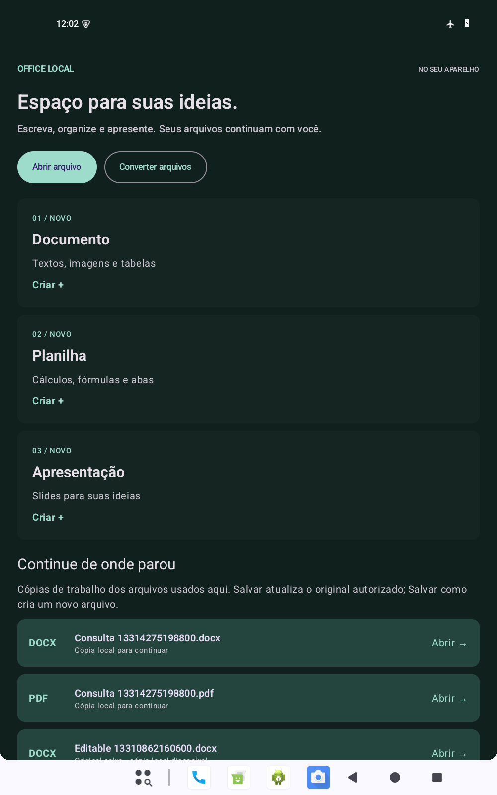
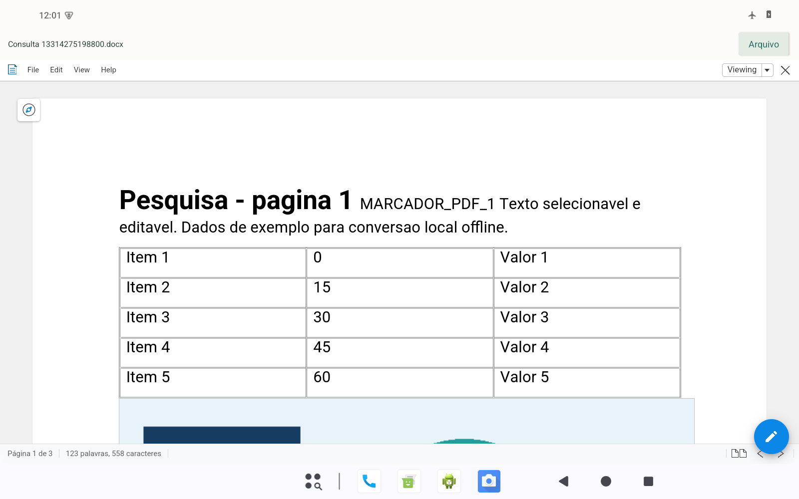
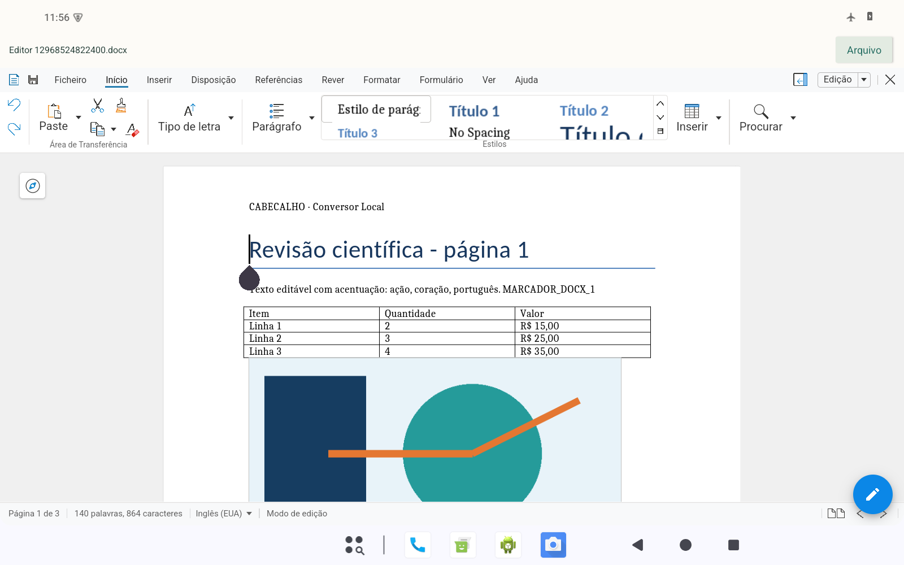
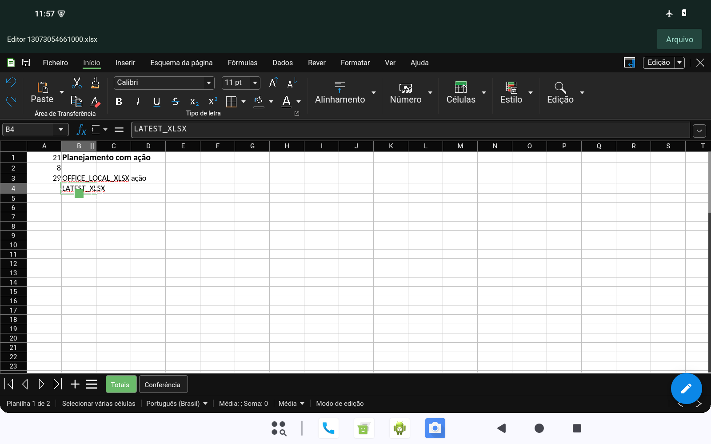
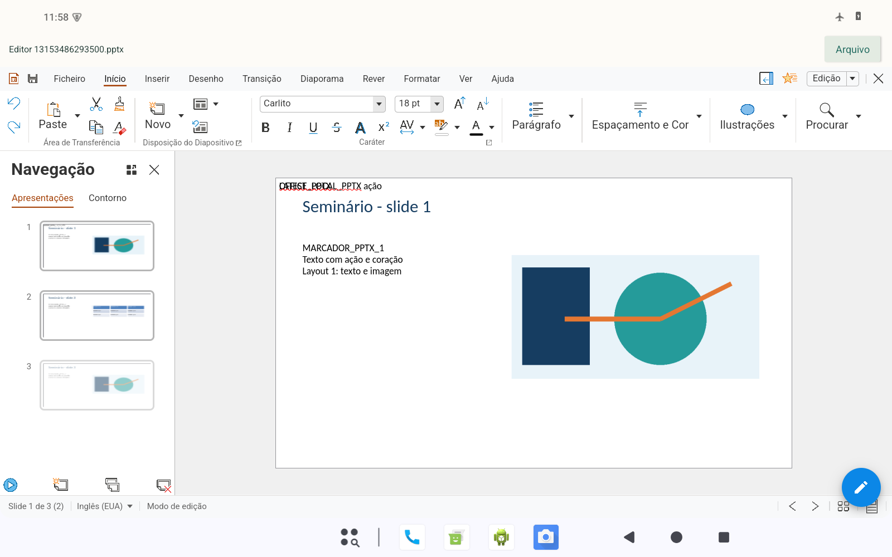

# Validação — Office Local

Registro de 19/10/2026 (horário de Brasília). **30 testes instrumentados e 2 testes JVM aprovados. Nenhum teste foi realizado em tablet físico.**

## Escopo e referência preservada

A base funcional foi `codex/android-offline`, commit `7f1490c2f8cc21acdb456e09d72b0af55c5d6c84`. Antes da integração, 11 testes instrumentados e 2 testes JVM passaram em nova execução. A aplicação Windows, `android/` e os workflows existentes não foram alterados.

Collabora: `cp-26.04.4-2`, commit `201368fc8ded1a0f28d1891c77e0410cb9416531`. MuPDF/Extract: 1.28.5, preservando a correção `c0c84ef8fe95ef5e6a373c3411d74802731915c71b298e0a02caf974451aa9a1`. Não foram misturadas ABIs do LibreOfficeKit antigo com COKit.

## Evidências

| Camada | Verificação |
| --- | --- |
| Base Collabora | Compilada das fontes; abrir, editar, salvar e reabrir DOCX em dois processos distintos, com imagem, três tabelas e acentos preservados |
| Conversor integrado | 14 testes aprovados: quatro rotas, páginas e conteúdo, retorno dos arquivos gerados ao motor Office, lote, cancelamento, entradas inválidas, SAF, somente leitura, colisões, original alterado externamente e recuperação separada de temporários |
| Navegação integrada | PDF consultado → convertido → DOCX publicado → aberto no editor em um processo novo; texto convertido conferido no arquivo e na captura |
| Tela inicial | Teste aprovado em paisagem 1600 × 1000, retrato 1000 × 1600 e tema escuro; cartões em linha/coluna conferidos e capturas inspecionadas |
| Editor integrado | 12 fases aprovadas: editar, salvar/reabrir em processo novo, criar e salvar/reabrir ODF nos três editores; exportação com a última alteração, rotação e cancelamento sem encerrar a edição |
| Fidelidade e temas | 21 comparações de páginas PDF com pixels idênticos entre temas; cores preservadas após reabertura, imagens DOCX/PPTX com pixels originais, tabelas/objetos conservados e contraste dos controles/células conferido |
| Teclado e janela | 2 testes aprovados: Ctrl+C/V/Z/S, acentos por clipboard, publicação por SAF e edição preservada ao redimensionar de 1600 × 1000 para 1200 × 900 e retornar |
| JVM / lint | 2 testes JVM aprovados; lint com 0 erros, 222 avisos e 1 sugestão, incluindo componentes upstream |
| ARM64 e x86_64 | Compilação nativa concluída; 17 bibliotecas por APK, ELF e offsets ZIP alinhados a 16 KB, assinatura e manifesto verificados |
| Dispositivo físico | Não utilizado |

A instrumentação usa Android 15 x86_64 em emulador dedicado, 1600 × 1000 pixels, densidade 200, com modo avião e Wi-Fi/dados desligados. A prova da base está em `artifacts/office-android/base/proof-two-phase/`; a referência do conversor, em `artifacts/office-android/baseline/`. Evidências finais são geradas em `artifacts/office-android/release/`, fora do Git.

Os cinco grupos de instrumentação registram o mesmo SHA-256 do APK x86_64 entregue. Os relatórios, capturas e saídas sintéticas estão no arquivo `OfficeLocal-0.2.0-validation.zip` da release; os arquivos `source.tar.gz` e `SHA256SUMS.txt` acompanham os APKs.

## O que mudou

- Tela inicial adaptativa para abrir/criar, converter e continuar cópias locais. Temas claro/escuro e identidade própria.
- Editores reais do Collabora, com suas ferramentas e recursos locais; ponte SAF pequena sobre `LOActivity`.
- Cópias de trabalho persistentes, confirmação de gravação e distinção entre Salvar, Salvar como, exportar e compartilhar.
- Exportação do documento atual depois da confirmação de salvamento local; resultado do conversor encaminhado ao editor interno.
- Processos `:editor` e `:conversion` separados. O encerramento intencional do editor upstream não encerra a página inicial nem a conversão.
- Mesma versão COKit para edição e exportação; MuPDF corrigido mantido para PDF → DOCX/PPTX.
- Macros desativadas na configuração nativa Android; validação adicional para planilhas e ODF.
- Nenhuma permissão INTERNET ou de acesso amplo aos arquivos. A única permissão declarada na inspeção é a permissão privada de receiver gerada pelo AndroidX.

## Ocorrências resolvidas

- Docker Desktop não iniciou por falha em `engine.sock`; a compilação usou WSL2 isolado com Ubuntu 24.04, sem redefinir o Docker.
- Ferramentas dos exemplos introdutórios não atendiam à revisão fixada. Foram utilizados JDK 21, SDK/Build Tools 37, NDK 29, Gradle 9.5 e AGP 9.3.
- O bootstrap Android precisa inicializar COKit pela VFS do APK; parâmetros de instalação de desktop causavam falha. A ponte segue a inicialização mobile upstream.
- Fechar um documento no Collabora encerra deliberadamente o processo. A integração isola esse comportamento, e a prova de reabertura usa um novo processo.
- Salvamento automático e exportação precisavam de ordenação. A integração aguarda confirmação nativa e serializa a recuperação com a operação explícita.
- Uma compilação incremental manteve um CSS vazio de um modo anterior. A inspeção visual detectou o defeito; a receita invalida os bundles gerados e os verificadores exigem CSS/JS completos no APK e CSS carregado no editor.
- Os testes foram ajustados para permissões SAF efetivas, destinos já autorizados, capitalização de botões e quebras de linha na extração de PDF. Essas adaptações não relaxam os critérios de conteúdo ou de preservação.
- A navegação PDF → DOCX revelou uma disputa com o encerramento nativo: esperar 1,2 segundo podia enviar o novo documento ao editor que ainda estava fechando. A página inicial agora verifica a saída do processo anterior antes de abrir o próximo; o teste exige um PID novo e o editor visível.
- A WebView disparava uma segunda ação de clipboard depois da cópia nativa. A ponte Android agora consome o evento; Ctrl+S usa a publicação SAF da suíte.
- O tema escuro do motor alterava a cor automática do texto de tabelas do Impress. A integração conserva o tema dos controles, mas fixa a paleta nativa do documento também no carregamento inicial e na inversão de fundo. O fundo CSS das páginas e das células transparentes também permanece claro para evitar texto preto sobre fundo escuro; as capturas aguardam a confirmação de pintura da WebView. O verificador compara todos os pixels dos PDFs claros/escuros na mesma sessão e as cores do texto após reabertura.

## Limites reais

- A assinatura é de desenvolvimento, identificada pelo certificado SHA-256 `87b7a79d61156ffd58a68e4e9e2796773c6521fb38f31eb545692cfb6c334dad`.
- Testes em emulador e inspeção de ELF/ZIP ARM64 não demonstram desempenho, compatibilidade gráfica ou funcionamento de teclado/mouse físicos no tablet do usuário.
- Não há OCR. PDF → PPTX contém imagens das páginas. PDF → DOCX mantém as limitações de reconstrução de layout do motor.
- Salvar e reimportar OOXML pode ajustar métricas/espaçamento de texto. A igualdade de pixels entre temas é verificada sobre o mesmo modelo carregado; após reabertura, verificam-se cores, texto, imagens e objetos. Não se promete reprodução idêntica de qualquer documento do Microsoft Office.
- A apresentação de teste tem três slides, um oculto. O PDF direto do editor inclui os dois visíveis; o conversor mantém sua opção anterior de incluir slides ocultos. O PPTX reaberto conserva os três slides.
- Arquivos de até 100 MB. Macros, recursos externos, objetos ativos e documentos criptografados são recusados; não houve redução global da segurança para aceitar arquivos problemáticos.
- A gravação em provedores SAF é conferida por leitura, sem promessa de atomicidade. Uma falha pode deixar o provedor com gravação incompleta; a cópia de trabalho e a cópia inicial permanecem no aplicativo.
- Recuperação periódica não equivale a persistir cada tecla. Cópias de trabalho ficam guardadas e não têm limpeza automática; a lista mostra as 30 mais recentes.
- Salvar como produz uma nova cópia; a sessão continua vinculada à origem aberta. O nome exibido no editor continua sendo o da sessão.
- O lint inclui avisos herdados do upstream e de APIs antigas. O aviso heurístico `UnsafeIntentLaunch` aponta a leitura de uma URI em `Sessions.import`; o código exige esquema `content`, verifica permissões reais e abre apenas uma atividade interna explícita, sem encaminhar um Intent recebido.

A planilha reaberta conserva duas abas e a fórmula `SUM(A1:A2)`, recalculada de 21 + 8 para **29**. O DOCX conserva três tabelas e três imagens. DOCX/ODT, XLSX/ODS e PPTX/ODP foram criados e editados; a reabertura ODF foi feita em processo novo.

## Pacotes de teste

Pacote `dev.diogo.officelocal`, versão `0.2.0-test-debug`, código 100, mínimo Android 8/API 26, alvo API 37. A assinatura de desenvolvimento permite instalação lado a lado com `dev.diogo.conversorlocal`. O sistema Android 15 x86_64 foi a única plataforma de execução nesta entrega.

| APK | Bytes | SHA-256 |
| --- | ---: | --- |
| OfficeLocal-0.2.0-arm64-test.apk | 399738033 | `f8a93c92fe0dbce465effb97ccd3e9eb95bcaedb387e29f46552b3140b838162` |
| OfficeLocal-0.2.0-x86_64-test.apk | 411421958 | `1b2aab3f2e95654f4ea518551f79efd9644a38d09a6309b6f6034188005bfb9c` |

O MuPDF empacotado reutiliza as bibliotecas corrigidas da referência, verificadas por SHA-256. A receita Linux reutiliza o mesmo construtor e patch; não foi feita uma nova compilação Linux desse componente durante a integração. Collabora e a ponte foram compilados das fontes para as duas arquiteturas.

## Capturas reais do emulador

Todos os documentos são sintéticos de teste. Não houve inspeção ou alteração de documentos pessoais.

