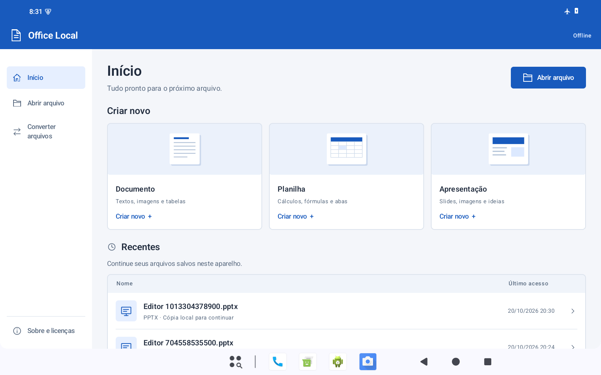
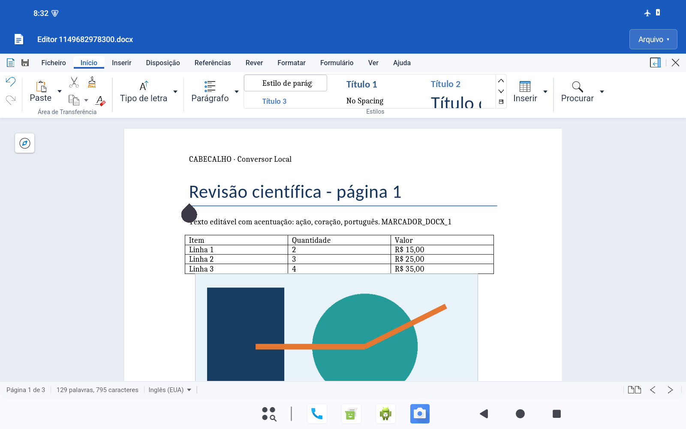
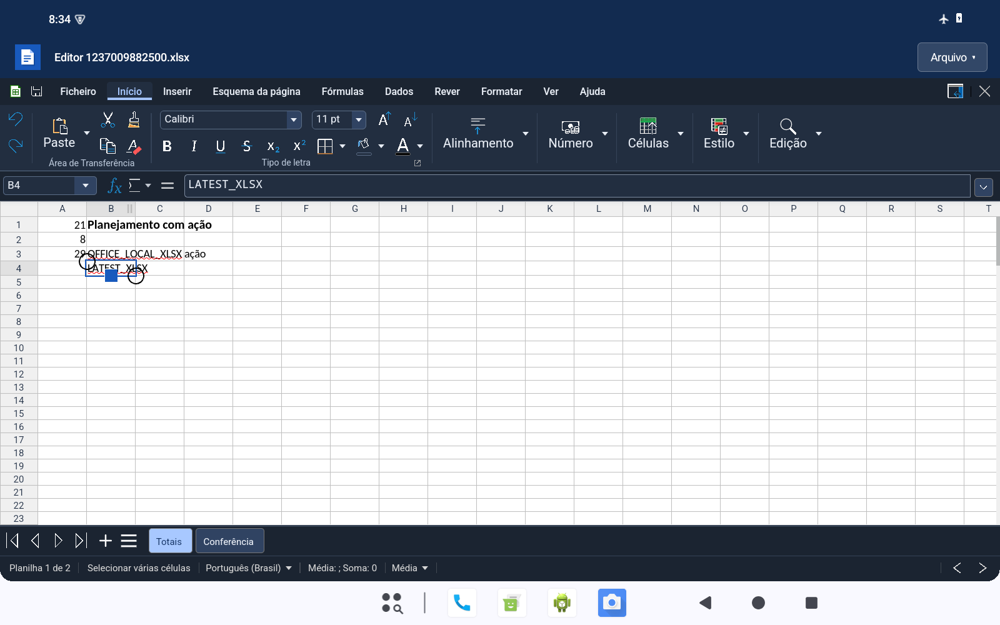
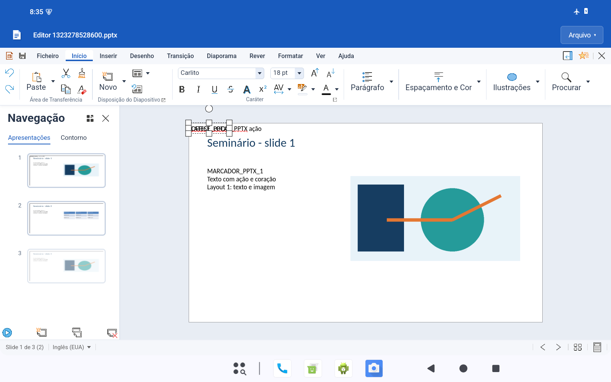
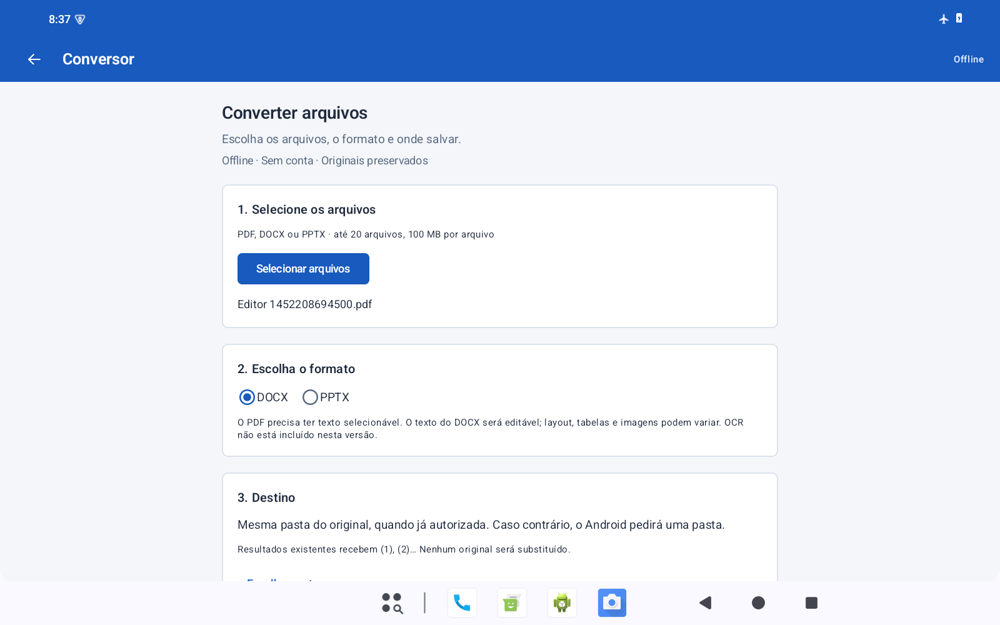

# Office Local 0.2.1 — interface azul e edição direta

Atualização de 20/10/2026 sobre a prévia 0.2.0, limitada à apresentação e ao modo inicial dos documentos. O conversor, os motores, as regras de salvamento, a recuperação e as permissões SAF continuam os mesmos.

## Interface

- Azul no ícone, na tela inicial, nos diálogos, no conversor e na barra do editor.
- Início com navegação lateral em telas largas, cartões com prévias de documentos e uma lista de recentes com tipo e data de acesso.
- Organização mais compacta, superfícies neutras, bordas discretas e contraste próprio para os temas claro e escuro.
- Barra de título azul com o nome do arquivo, acesso à página inicial e menu Arquivo. As abas e ferramentas reais do Collabora continuam disponíveis.
- A folha e as cores dos documentos permanecem independentes do tema dos controles.

## Edição

DOCX/ODT, XLSX/ODS e PPTX/ODP abrem diretamente em edição. O seletor Visualização/Edição, o lápis flutuante e o indicador redundante de modo foram retirados. Voltar usa a saída existente, com as opções de salvar ou manter a edição para continuar depois.

Esse ajuste não concede escrita ao arquivo original. Um documento recebido somente para leitura continua editável na cópia local; Salvar pede um destino para essa cópia. PDFs conservam a consulta e a conversão para DOCX, sem anunciar uma capacidade de edição de PDF que o aplicativo não oferece.

## Validação desta atualização

Os APKs finais foram compilados para ARM64 e x86_64. A execução funcional ocorreu em emulador Android 15 x86_64, 1600 × 1000, densidade 200, em modo avião e com Wi-Fi/dados desligados. Todos os grupos abaixo registraram o mesmo SHA-256 do APK x86_64 publicado.

| Verificação | Testes aprovados |
| --- | ---: |
| Conversões, lote, nomes, arquivos e permissões SAF | 14 |
| Edição, salvamento, reabertura e criação nos seis formatos | 12 |
| Teclado e redimensionamento | 2 |
| Tela inicial adaptativa, retrato e temas | 1 |
| Cópia editável de original somente para leitura e saída | 1 |
| PDF para consulta e abertura do conversor | 1 |
| PDF → DOCX → editor integrado | 1 |
| **Total instrumentado** | **32** |
| Regras locais em JVM | 2 |

A entrada automática em edição aguarda o documento e a fila inicial de layout. Esse ajuste evita o bloqueio observado ao antecipar a edição antes da montagem da barra de apresentações. Os testes conferem a edição ativa e a ausência do seletor e do lápis, sem forçar a permissão de edição pelo teste.

- Edição e reabertura em processo novo preservaram texto, imagens, tabelas, fórmulas e slides das amostras sintéticas. As 21 comparações de páginas PDF exportadas entre temas claro e escuro tiveram pixels idênticos.
- O teste de acesso somente para leitura editou a cópia local, pediu destino para salvar e verificou que o original permaneceu intacto. Voltar apresentou o diálogo de saída; Continuar manteve a edição.
- A atualização sobre 0.2.0 preservou por hash os metadados das 68 sessões sintéticas que já existiam. Isso não representa uma auditoria integral de todos os arquivos de trabalho.
- Ambos os APKs passaram na verificação de assinatura, manifesto, 17 bibliotecas nativas e alinhamento ZIP/ELF de 16 KB. Não há permissão INTERNET. Collabora/COKit e MuPDF/Extract têm os mesmos hashes da versão anterior, em ambas as arquiteturas.
- Lint: zero erros, 219 avisos e 1 sugestão. São mantidos os avisos do conjunto integrado; a compilação e os testes passaram.

**Limite da validação:** ARM64 teve verificação de compilação e empacotamento, sem execução desta atualização em tablet físico. A assinatura continua sendo de desenvolvimento. Permanecem as limitações de conversão de PDF descritas no README.

| APK | SHA-256 |
| --- | --- |
| ARM64 | `5620c8e291ec3677ad1821202a1eedc9c233a488cadf412a7048d3ed88f5986b` |
| x86_64 | `427776130497fa195860f0e27acf6a54b96d2824ab5980540798d5fdc90b9386` |

Resultados, manifestos, auditoria de exportações e saídas sintéticas estão em `OfficeLocal-0.2.1-validation.zip`, na entrega. Não são incluídos documentos pessoais nem logcat bruto. A referência anterior permanece no [relatório da versão 0.2.0](https://github.com/diogo9467/conversor-local/blob/office-android-v0.2.0-test.1/office-android/docs/validation.md).

## Capturas reais

Início em paisagem:

Documento em edição:

Planilha no tema escuro:

Apresentação em edição:

Conversor no tema claro:

Também estão disponíveis as capturas do [início em retrato](images/0.2.1/home-portrait-light.png), [início escuro](images/0.2.1/home-portrait-dark.png), [Writer escuro](images/0.2.1/writer-dark.png), [conversor escuro](images/0.2.1/converter-dark.png), [cópia editável](images/0.2.1/read-only-copy-editable.png), [diálogo de saída](images/0.2.1/exit-dialog.png) e [consulta de PDF](images/0.2.1/pdf-consultation.png).

## Instalação e fontes

Pacote `dev.diogo.officelocal`, código 101, versão de teste 0.2.1. A distribuição usa a mesma chave de desenvolvimento da prévia anterior para permitir a atualização por cima do aplicativo instalado, preservando suas cópias locais. Não é necessário desinstalar a versão anterior.

As instruções de compilação estão no [README](../README.md). O código próprio e os patches correspondentes acompanham a nova entrega. Os arquivos-fonte do Collabora, MuPDF, traduções e dependências nativas continuam nas fontes da [prévia 0.2.0](https://github.com/diogo9467/conversor-local/releases/tag/office-android-v0.2.0-test.1); esses componentes não foram atualizados.
